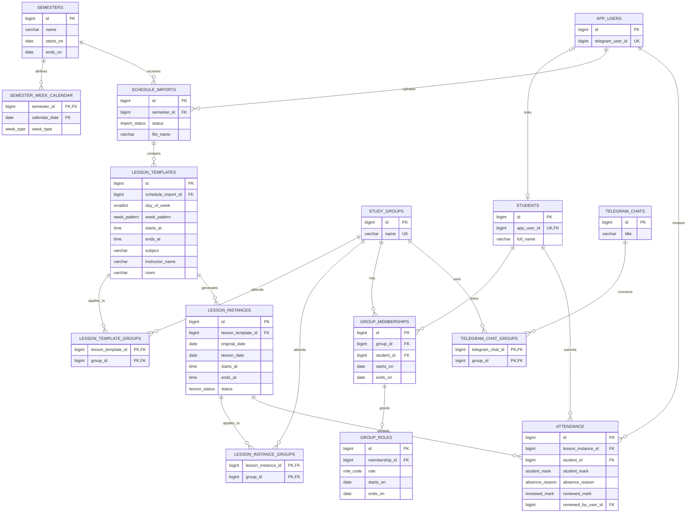

# Проектирование базы данных

Первая версия схемы рассчитана на PostgreSQL. Она разделяет шаблон повторяющегося расписания и конкретную пару в календаре, чтобы поддержать верхние и нижние недели, переносы и отмены.

## ER-диаграмма

## Основные правила

- `semester_week_calendar` содержит дату и тип недели (`TOP` — верхняя, `BOTTOM` — нижняя) для каждой даты семестра. Соответствие не выводится из чётности номера недели.
- Шаблон занятия хранит день недели, время и `week_pattern`: `EVERY`, `TOP` или `BOTTOM`. В шаблонных занятиях участвуют одна или несколько групп.
- При публикации расписания шаблоны разворачиваются в `lesson_instances` на конкретные даты. В таблице конкретных занятий сохраняются группы, чтобы последующие изменения шаблона не меняли историю. У перенесённой пары `original_date` остаётся прежней, а `lesson_date` указывает новую дату. Для разовой пары шаблон и исходная дата не задаются.
- Отменённая пара остаётся в базе со статусом `CANCELLED`. Это сохраняет историю и позволяет не создавать отметки для отменённых занятий.
- Список студентов и Telegram-пользователи разделены. У студента может пока не быть связанного аккаунта; список можно заполнить вручную или загрузить из текстового файла.
- Членство в группе имеет даты действия. Не следует удалять бывших студентов: завершайте членство, чтобы сохранить историю посещаемости.
- Один чат Telegram можно связать с несколькими группами, а группа может иметь несколько чатов.
- Для каждого студента и конкретной пары допускается не более одной записи посещаемости. `student_mark` — самоотметка (`PRESENT`, `LATE`, `ABSENT`); причина отсутствия (`ILLNESS`, `OTHER`) необязательна. Болезнь — причина, не итоговый статус. Староста проверяет отметку и задаёт `reviewed_mark` (`PRESENT`, `LATE`, `EXCUSED`, `UNEXCUSED`).
- Диагнозы и медицинские документы не хранятся. Проверка полномочий старосты и доступ к персональным данным должны выполняться приложением.
- Excel-файл хранится вне базы; `schedule_imports.storage_key` содержит ссылку на защищённое хранилище. История импорта позволяет отслеживать загрузки и ошибки.

## План развёртывания расписания

1. Загрузить Excel и создать запись `schedule_imports` со статусом `UPLOADED`.
2. Разобрать таблицу, проверить группы, даты и интервалы; сохранить выявленные ошибки.
3. Сохранить проверенные шаблоны занятий и участвующие группы.
4. Для дат семестра свериться с календарём верхних и нижних недель и создать конкретные пары.
5. После проверки сделать импорт активным, установив ему статус `PUBLISHED`. В одном семестре может быть только один опубликованный импорт.

Для новых версий расписания создаётся новый импорт. Приложение должно обновлять или пересоздавать только будущие пары; прошедшие пары и посещаемость сохраняются как история.
